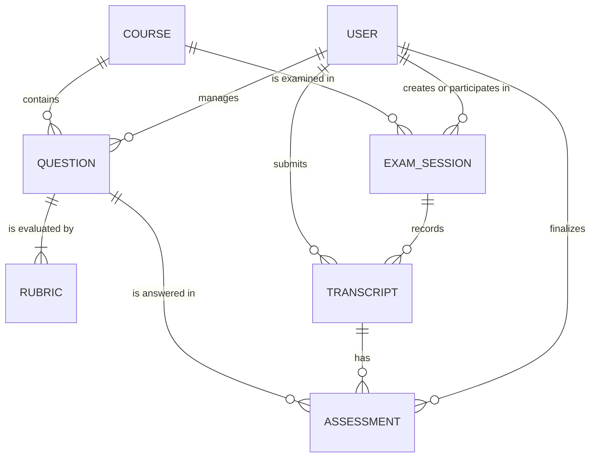

# Conceptual ERD — AIVES Complete System

This conceptual model shows the complete AIVES assignment using entity names and
business relationships only. Attributes are intentionally omitted.

`User`, `Course`, `Question`, and `Rubric` are implemented in the current
backend. `ExamSession`, `Transcript`, and `Assessment` belong to the planned
Flow 3/4 model and are included here because this is the conceptual ERD for the
complete assignment.
